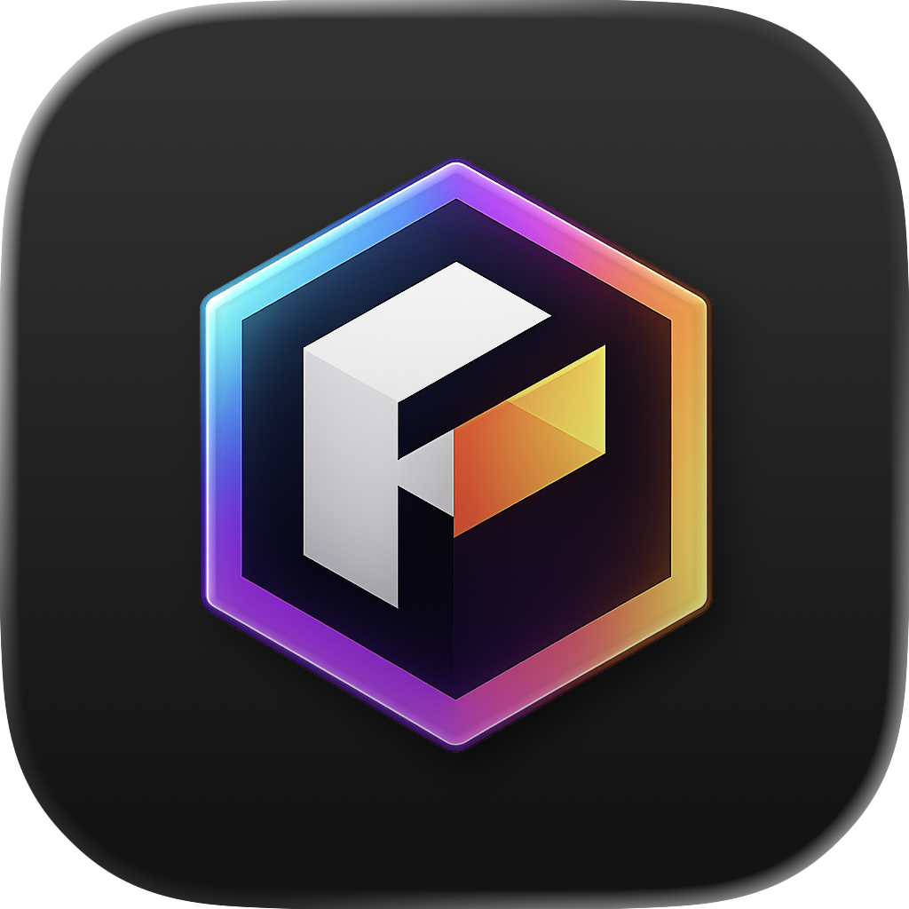
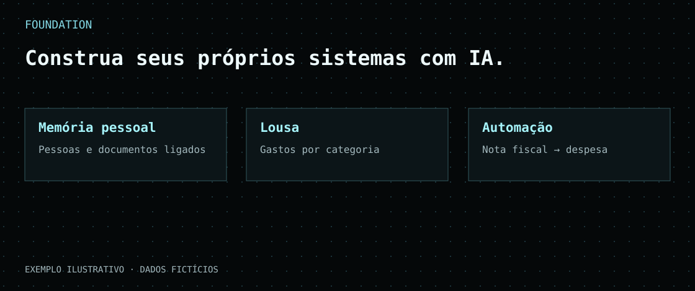
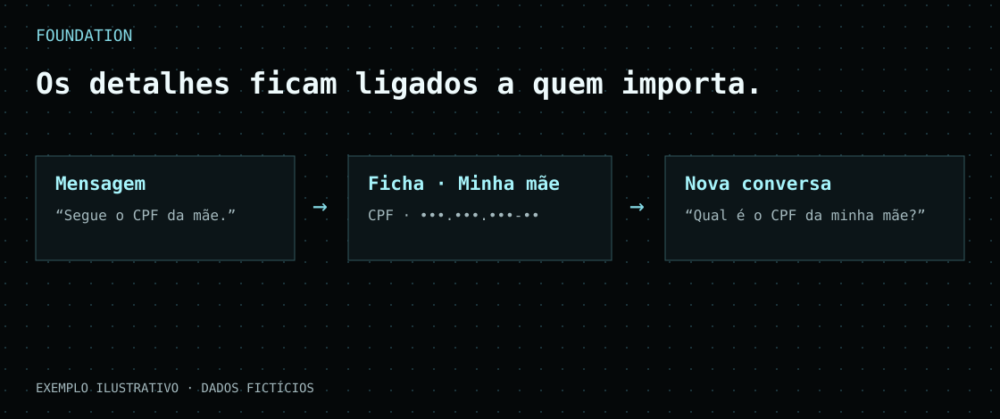
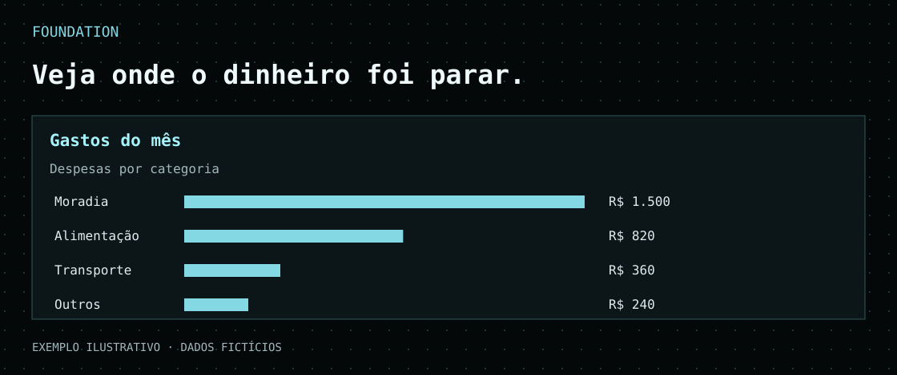
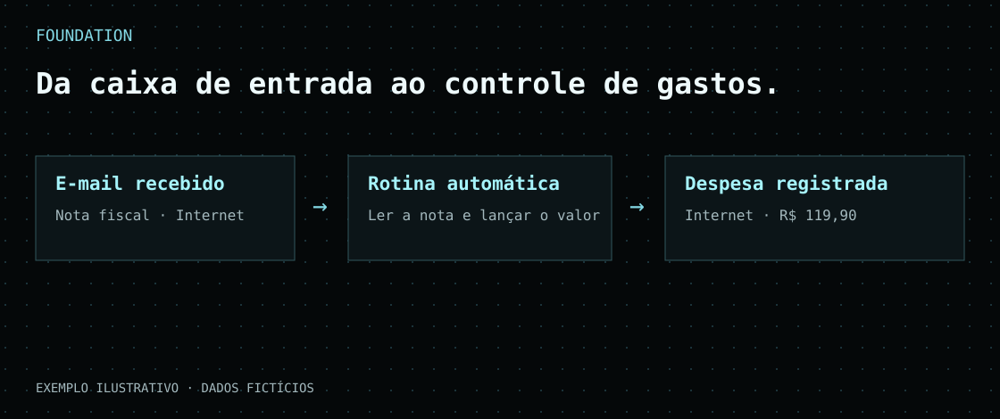

# FOUNDATION

  

**A fundação para construir seus próprios sistemas com IA.**

Controle suas finanças, organize seus documentos e automatize o trabalho que se repete.

> **Status:** versão alfa. [Baixe o Foundation](#baixe-o-foundation).

## Uma memória inteligente para você e sua IA.

Você está marcando um exame para sua mãe e pedem o CPF dela. Será que está no WhatsApp, num arquivo do Drive ou naquele e-mail que você já nem consegue acessar?

No chat e no e-mail, sua IA guarda automaticamente os detalhes importantes no **seu grafo de conhecimento (ontologia)**, armazenado no seu próprio computador, sob seu controle. Quando a integração planejada com o WhatsApp estiver disponível, sua IA também poderá lembrar do que foi dito por lá. O CPF fica na ficha da sua mãe. Quando precisar dele, basta perguntar à sua IA, mesmo em uma conversa nova.

A integração com o WhatsApp é o próximo foco do projeto.

## Mais do que palavras.

Onde foi parar o dinheiro deste mês? Na lousa do Foundation, sua IA monta um gráfico dos seus gastos por categoria. Você vê de cara o que mais pesou no orçamento e pode abrir os detalhes antes de decidir onde economizar.

A lousa é o espaço onde você e sua IA exploram informações juntos. Quando uma comparação ajuda a entender os dados, sua IA cria uma visualização para a decisão que você tem pela frente.

## Resolva uma vez. Ganhe tempo todo mês.

Todo mês, a nota fiscal da internet chega por e-mail. Você abre a mensagem, confere o valor e lança a despesa. No Foundation, você cria essa rotina com sua IA uma vez. Quando a próxima nota chegar, ela é registrada no seu controle de gastos automaticamente.

Se o valor vier diferente do esperado, sua IA pode ajudar a entender o que mudou antes de você decidir o que fazer.

## Baixe o Foundation

O Foundation é **gratuito, de código aberto e não exige assinatura**. Os serviços de IA externos têm seus próprios planos e preços.

Instale o Foundation e escolha como usar sua IA. A versão em desenvolvimento integra **Claude pela API da Anthropic (requer chave de API; assinatura do Claude não é aceita)**, **OpenRouter**, **API da OpenAI** e **ChatGPT por assinatura**. Você também pode executar um **modelo local** no seu computador. As opções disponíveis variam conforme a versão instalada.

| Plataforma | Instalador |
| --- | --- |
| macOS (Apple Silicon) | [Baixar .dmg — v0.18.1](https://github.com/danielterra/FOUNDATION/releases/download/v0.18.1/FOUNDATION_0.18.1_aarch64.dmg) |
| Windows (64 bits) | [Baixar .exe — v0.18.1](https://github.com/danielterra/FOUNDATION/releases/download/v0.18.1/FOUNDATION_0.18.1_x64-setup.exe) |
| Linux (64 bits) | [AppImage](https://github.com/danielterra/FOUNDATION/releases/download/v0.19.0/FOUNDATION_0.19.0_amd64.AppImage) · [Ubuntu e Debian (.deb)](https://github.com/danielterra/FOUNDATION/releases/download/v0.19.0/FOUNDATION_0.19.0_amd64.deb) · [Fedora (.rpm)](https://github.com/danielterra/FOUNDATION/releases/download/v0.19.0/FOUNDATION-0.19.0-1.x86_64.rpm) — v0.19.0 |

**Precisa de ajuda?** Escreva para [daniel_terra@icloud.com](mailto:daniel_terra@icloud.com).
